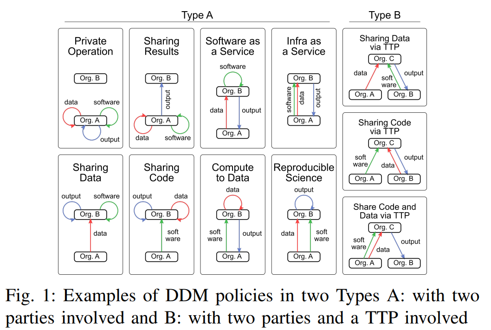

# Data Exchange Archetypes Formalisations

Formalisation of the 11 data exchange archetypes (see picture below) identified in   

__Evaluation of Container Overlays for Secure Data Sharing__  
Sara Shakeri, Lourens Veen, and Paola Grosso  
[DOI](https://doi.org/10.1109/LCNSymposium50271.2020.9363266)

